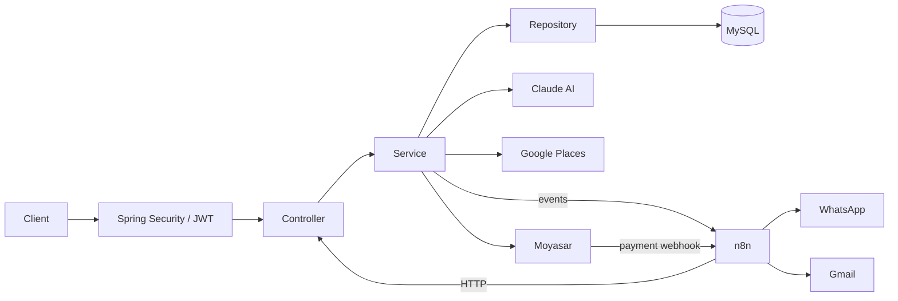
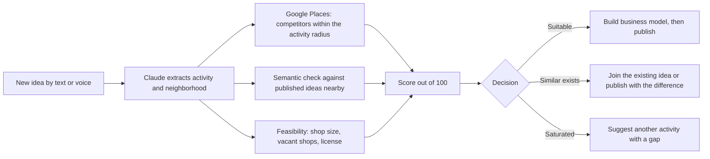
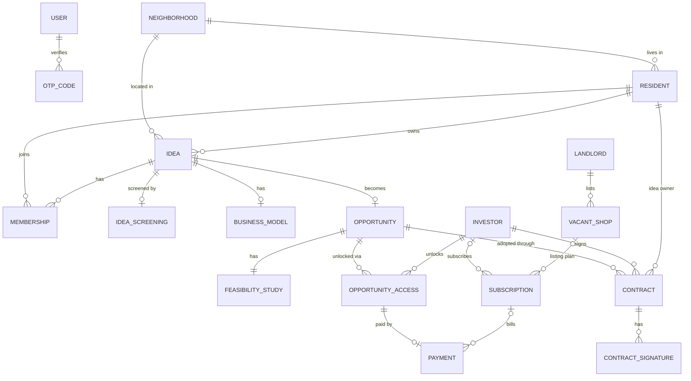

<div align="center">


**Neighborhood demand platform powered by AI**

منصة يطلب فيها سكان الحي المحلات والخدمات اللي تنقصهم، ويستخدم المستثمرون هذا الطلب الموثّق لفتح المشروع في المكان الصح


</div>

---

Naseej is a platform where neighborhood residents request the shops and services they're missing, and investors use that verified demand to pick the right project and the right location. Before any idea goes live, AI checks whether the activity is really scarce nearby and whether a similar idea already exists, then helps the idea owner build a business model. Posting and joining are free, and every resident who joins becomes a founding member. When a request is complete, investors unlock it with a one-time fee or a success partnership, and if they adopt it, the idea owner and founding members get perks in the new business. It starts with a pilot in Riyadh neighborhoods.

> The prototype has 16 connected screens across three journeys: resident, idea owner and investor.

## 📑 Table of Contents

- [Who It's For](#️-who-its-for)
- [Features](#-features)
- [Tech Stack](#️-tech-stack)
- [Integrations](#-integrations)
- [n8n Workflows](#️-n8n-workflows)
- [Architecture](#️-architecture)
- [How Idea Screening Works](#-how-idea-screening-works)
- [Idea Lifecycle](#-idea-lifecycle)
- [Contracts](#️-contracts)
- [Authentication & Roles](#-authentication--roles)
- [Revenue Model](#-revenue-model)
- [Data Model](#️-data-model)
- [Project Structure](#-project-structure)
- [Getting Started](#-getting-started)
- [Test Data](#-test-data)
- [API Overview](#-api-overview)
- [Team](#-team)
- [Endpoints](#-endpoints)

## 🏘️ Who It's For

| Side | Problem today | What Hayyina gives them |
|---|---|---|
| **Resident** | No place to ask for a laundry, pharmacy or gym nearby, and requests get lost in WhatsApp groups | Request or join for free as a founding member, and follow the request until opening |
| **Idea owner** | Doesn't know if the idea is wanted, duplicated or viable | AI screening before publishing, a ready business model, and owner perks if an investor adopts it |
| **Investor** | Picks locations by guesswork and opens a sixth café on a street with no laundry | Verified demand from real residents, a short feasibility study and nearby vacant shops |
| **Landlord** | Shop sits empty for months | The shop appears inside opportunities that fit its location |

## ✨ Features

- **Requests by text or voice**: residents describe what's missing in their own dialect, and the AI turns it into a specific activity and neighborhood.
- **Idea Screening AI**: before publishing, the AI checks scarcity within an activity-specific radius using Google Places, looks for similar ideas by meaning, checks feasibility, and returns a score out of 100 with one of three decisions.
- **Business Model Assistant AI**: the AI drafts a business model from the screening results, and the idea owner edits it by chatting (e.g. "add kids' classes").
- **Similar-request merging**: semantic matching suggests joining an existing request instead of posting a duplicate. "مغسلة" and "لاندري" count as the same idea.
- **Free founding membership**: residents post and join for free. A member counts only after email OTP and residence verification, so the numbers investors see stay real.
- **Demand map**: neighborhoods are colored by vote count for each activity.
- **Feasibility Study AI**: when a request reaches its threshold (e.g. 150 verified members), investors get a short study with a gap score, competitors within 2 km, a recommendation and risks.
- **Investor search & access**: investors search by target neighborhood, capital or project name, then unlock an opportunity with a one-time fee through Moyasar or a success partnership.
- **In-platform contracts**: the investor and the idea owner sign inside the platform, and the active contract is emailed as an official PDF.
- **Vacant shops**: landlords list empty shops, which appear inside nearby opportunities.
- **Notifications**: residents, idea owners and investors are notified on WhatsApp and by email when a request completes, an idea is adopted and a business opens.
- **Secure accounts**: stateless JWT authentication with Google sign-in or email and password, email OTP, and Nafath verification for investors.

## 🛠️ Tech Stack

| Layer | Technology |
|---|---|
| Language | Java 17+ |
| Framework | Spring Boot 3 (Spring Web) |
| Security | Spring Security, OAuth2 Client (Google), JWT (access + refresh tokens), BCrypt |
| Persistence | Spring Data JPA, Hibernate |
| Database | MySQL |
| Validation | Jakarta Validation |
| Boilerplate | Lombok |
| Automation | n8n (webhooks, WhatsApp, Gmail) |
| Payments | Moyasar (Apple Pay, mada, credit cards) |
| Testing | Postman |
| Version control | Git & GitHub |

## 🔌 Integrations

| Service | Used for | How we integrated it |
|---|---|---|
|  **Claude AI** | Request understanding, Idea Screening, Business Model, Feasibility Study | The server sends the idea, Google Places results and nearby published ideas to Claude. Every response comes back as JSON and is validated by the server before it is saved. |
|  **Google Places API** | Scarcity check, competitors | Finds businesses of the same type within a radius that fits the activity, then calculates the count and nearest competitor and compares them with the city average. |
|  **Google Maps** | Demand map | Shows neighborhoods colored by the number of votes for each activity. |
|  **Google OAuth2** | Sign-in | `oauth2Login()` signs the user in. New users are created with the `PENDING` role, sent to the membership page, then issued a JWT. |
| 💳 **Moyasar** | Payments and refunds | Moyasar's ready payment form handles Apple Pay, mada and cards, so card data never reaches our server. An opportunity is unlocked only after Moyasar's webhook confirms the payment, and refunds go through the Refund API. |
|  **n8n** | Automation | Spring Boot and Moyasar trigger n8n workflows through webhooks for screening, alerts, contracts, deadlines and digests. |
|  **WhatsApp** | Alerts | Sent by n8n: request completed, idea adopted, contract ready to sign, business opened. |
|  **Gmail** | OTP codes and contracts | Connected in n8n through an OAuth2 credential from the platform's official account, so emails arrive from "Hayyina" and not from a person. |
| 🪪 **Nafath** | Investor verification | Investors must verify their identity through Nafath before they can access opportunities. |

Every AI result is validated by the server before it is stored or used in any payment step, and nothing is unlocked for an investor before Moyasar's webhook arrives. Moyasar keys are kept in environment variables.

## ⚙️ n8n Workflows

| Workflow | Trigger | What it does |
|---|---|---|
| New idea | Webhook from the app | Sends the idea for screening, saves the result and notifies neighbors interested in that activity |
| Request completed | Vote threshold reached | Generates the feasibility study and alerts investors interested in that neighborhood and activity |
| Payment confirmed | Webhook from Moyasar | Unlocks the opportunity for the investor and issues the VAT invoice |
| Adoption follow-up | Investor adopts an opportunity | Asks the idea owner to sign, emails the contract PDF once paid and signed, and follows up every two weeks |
| Adoption expired | 90 days without opening | Returns the opportunity to other investors and updates the founding members |
| Email OTP | Sign-up or login | Sends the 6-digit code through Gmail |
| Weekly digest | Every Sunday | Sends investors the top rising requests |

## 🏗️ Architecture



## 🔍 How Idea Screening Works

No idea is published before the AI answers three questions: is this activity actually scarce in the area, has a similar idea already been posted, and is the idea feasible?



The search radius depends on the activity, for example:

| Activity | Radius |
|---|---|
| Supermarket | 1 km |
| Barbershop | 1.5 km |
| Gym | 3 km |

| Decision | When it shows | What the idea owner is offered |
|---|---|---|
| `SUITABLE` | Clear gap and no matching idea in the neighborhood | Continue to the business model, then publish |
| `SIMILAR_EXISTS` | A close idea is posted in the same or a nearby neighborhood | Join it, or publish separately and explain the difference |
| `SATURATED` | Competitors clearly above the city average (e.g. 9 barbershops within 1.5 km) | An alternative activity that is scarce in the same neighborhood |

## Use Case Diagram

<p align="center">
  <a href="assets/docs/UseCaseDiagram.svg">
    
  </a>
</p>

## Class Diagram

<p align="center">
  <a href="assets/docs/ClassDiagram.svg">
    
  </a>
</p>

## 🔐 Authentication & Roles

Login is stateless: passwords are hashed with BCrypt, emails are verified with an OTP or by Google, and every request carries a JWT with the user's identity and role.

1. **Sign up** with Google in one click, or with email and password plus name, neighborhood and mobile number (for WhatsApp alerts).
2. **Choose a membership**: Google users go to a page to pick resident (with their neighborhood) or investor; email users pick it in the sign-up form.
3. **Verify the email**: a 6-digit code sent through n8n and Gmail, valid for 5 minutes and locked after 5 wrong attempts. Google accounts skip this step.
4. **Get tokens**: a short-lived access token and a refresh token.
5. **Log in later** with Google, email and password, or an email code.
6. **Investors verify with Nafath** before accessing opportunities.

| Role | Can |
|---|---|
| `PENDING` | Google user before choosing a membership, can only reach the membership page |
| `RESIDENT` | Post ideas, join as a founding member, sign the contract as idea owner |
| `INVESTOR` | Search, pay or choose a success partnership, adopt opportunities and sign contracts |
| `LANDLORD` | List vacant shops |
| `ADMIN` | Manage users and opportunities, receive a copy of every contract |

## 💰 Revenue Model

Residents and idea owners use the platform for free. Whoever benefits commercially from the demand pays. Prices are proposals for testing with the first investors.

| Source | Who pays | Proposed price |
|---|---|---|
| Opportunity access fee | Investor | 1,500 SAR + VAT per opportunity |
| Success partnership | Investor who doesn't want to pay upfront | 5% of net profit for 3 years after opening |
| Investor subscription | Active investors | 299 or 999 SAR per month |
| Vacant shop listing | Landlords | 199 SAR per month per shop |

## 🗄️ Data Model

| Entity | Description |
|---|---|
| `User` | Shared account fields (name, email, phone, role, auth provider), extended by Resident, Investor, Landlord and Admin |
| `Resident` | Lives in a neighborhood, posts ideas, joins as a founding member and signs contracts as idea owner |
| `Investor` | Nafath-verified account that searches, unlocks and adopts opportunities |
| `Landlord` | Lists vacant shops |
| `Admin` | Manages users and opportunities and issues refunds |
| `OtpCode` | Hashed email code with expiry time and attempt count |
| `Neighborhood` | Neighborhood name, city and coordinates |
| `Idea` | A resident's request with activity type, optional voice note, vote threshold and status |
| `IdeaScreening` | AI screening result: score, radius, competitors, nearest competitor, city average, similar idea and decision |
| `BusinessModel` | AI-drafted business model the idea owner edits by chat |
| `Membership` | A resident's founding membership in an idea |
| `Opportunity` | A completed idea open to investors, with its access fee |
| `FeasibilityStudy` | Gap score, competitors within 2 km, recommendation and risks |
| `OpportunityAccess` | How an investor unlocked an opportunity: one-time fee or success partnership |
| `Payment` | Moyasar payment with VAT, method, status and invoice |
| `Subscription` | Monthly investor or shop-listing plan |
| `Contract` | Investor and idea owner contract with perk percentages, status, signing dates, PDF and opening deadline |
| `ContractSignature` | Proof of a signature: typed name, drawn signature, time, IP address and email-code result |
| `VacantShop` | A landlord's shop with area, rent, location and availability |



## 📁 Project Structure

```
com.example.hayyina
├── Advice       # Global exception handling
├── Api          # ApiException and ApiResponse
├── Config       # Security, OAuth2, Claude, Google Places, Moyasar and n8n configs
├── Controller   # REST endpoints
├── DTOIN        # Request bodies with validation
├── DTOOUT       # Response bodies
├── Enums        # Role, IdeaStatus, ScreeningDecision, OpportunityStatus, AccessType, ContractStatus, PaymentStatus, SubscriptionPlan
├── Model        # JPA entities
├── Repository   # Database access
├── Security     # JwtAuthenticationFilter, AuthenticationSuccessHandler
└── Service      # Business logic
```

## 🚀 Getting Started

1. Clone the repository:
   ```
   git clone https://github.com/<your-org>/Hayyina.git
   ```
2. Create a MySQL database and set the connection details in `src/main/resources/application.properties`.
3. Set the keys as environment variables and reference them in the configuration:
   ```properties
   claude.api.key=${CLAUDE_API_KEY}
   claude.model=${CLAUDE_MODEL}
   google.places.api.key=${GOOGLE_PLACES_API_KEY}
   spring.security.oauth2.client.registration.google.client-id=${GOOGLE_CLIENT_ID}
   spring.security.oauth2.client.registration.google.client-secret=${GOOGLE_CLIENT_SECRET}
   jwt.secret=${JWT_SECRET}
   moyasar.secret.key=${MOYASAR_SECRET_KEY}
   moyasar.publishable.key=${MOYASAR_PUBLISHABLE_KEY}
   n8n.webhook.url=${N8N_WEBHOOK_URL}
   ```
4. Import the n8n workflows and add a Gmail OAuth2 credential from the platform's official account.
5. Run the application from your IDE, or with:
   ```
   ./mvnw spring-boot:run
   ```

Use Moyasar's test keys and test cards during development.

## 🧪 Test Data

| Role | Email | Password | Notes |
|---|---|---|---|
| Admin | `TODO` | `TODO` | Receives a copy of every contract |
| Resident | `TODO` | `TODO` | Residence verified, owns an idea |
| Resident | `TODO` | `TODO` | Founding member of that idea |
| Investor | `TODO` | `TODO` | Nafath verified |
| Investor | `TODO` | `TODO` | Not verified, can't access opportunities |
| Landlord | `TODO` | `TODO` | Has a vacant shop listed |

These accounts are for development only.

## 📊 API Overview

All endpoints start with `/v1/api`. Sign-up and login endpoints are public, and everything else needs a JWT in the `Authorization: Bearer` header. Role-specific operations are protected with `@PreAuthorize`, for example `hasRole('INVESTOR')` to sign a contract.

| Controller | Handles |
|---|---|
| Auth | Sign-up, OTP, login, tokens, Google sign-in and role selection |
| Idea | Posting ideas, screening, business model and the demand map |
| Membership | Joining ideas as a founding member and residence verification |
| Opportunity | Investor search, feasibility study, access and adoption |
| Payment | Moyasar payments, webhook confirmation and refunds |
| Contract | Drafting, signing, activation and progress updates |
| Subscription | Investor and shop-listing plans |
| VacantShop | Landlord shop listings |
| Neighborhood | Neighborhoods and their coordinates |
| Admin | Managing users and opportunities |

## 👥 Team

<table>
  <tr>
    <td align="center" width="33%">
      <a href="https://github.com/AHMEDALHAMAMI"><br><b>ِAhmad Alhamami</b></a><br>
      <sub> AI feature</sub><br><br>
      Responsibilities<br><br>
      <b>0</b> extra endpoints
    </td>
    <td align="center" width="33%">
      <a href="https://github.com/WaleedAlaql"><br><b>Waleed Alaql</b></a><br>
      <sub> AI feature</sub><br><br>
      Responsibilities<br><br>
      <b>0</b> extra endpoints
    </td>
    <td align="center" width="33%">
      <a href="https://github.com/AmiraAldajani"><br><b>Amira Aldajani</b></a><br>
      <sub> AI feature</sub><br><br>
      Responsibilities<br><br>
      <b>0</b> extra endpoints
    </td>
  </tr>
</table>

## 🧩 Endpoints


<details open>
<summary>&nbsp;<b>Authentication</b> (7)</summary>

| Method | Endpoint | Description |
|---|---|---|
| `POST` | `/v1/api/auth/register` | Sign up with email, password, name, neighborhood, mobile and membership type |
| `POST` | `/v1/api/auth/verify-otp` | Verify the 6-digit email code |
| `POST` | `/v1/api/auth/login` | Log in and get access and refresh tokens |
| `POST` | `/v1/api/auth/refresh` | Get a new access token from the refresh token |
| `POST` | `/v1/api/auth/logout` | Log out |
| `GET` | `/oauth2/authorization/google` | Start Google sign-in |
| `PUT` | `/v1/api/auth/select-role` | Choose resident or investor after Google sign-in |

</details>

<!-- Add one <details> block per team member with their endpoints, in the same format as Authentication above -->
## Resources


## 📬 Contact

<table>
  <tr>
    <td align="center" width="33%">
      <a href="https://www.linkedin.com/in/ahmedalhamami"><br><b>Ahmad Alhamami</b></a><br><br>
      <a href="https://github.com/AHMEDALHAMAMI"></a>
    </td>
    <td align="center" width="33%">
      <a href="https://www.linkedin.com/in/waleed-alaql"><br><b>Waleed Alaql</b></a><br><br>
      <a href="https://www.linkedin.com/in/waleed-alaql"></a>
    </td>
    <td align="center" width="33%">
      <a href="https://www.linkedin.com/in/amira-aldajani-2b0296222/"><br><b>Amira Aldajani</b></a><br><br>
      <a href="https://www.linkedin.com/in/amira-aldajani-2b0296222/"></a>
    </td>
  </tr>
</table>


